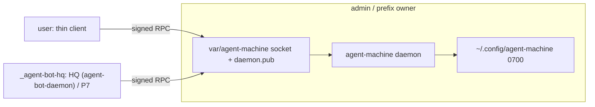

# Cross-account signed channel

Companion to [machine-daemon.md](machine-daemon.md) (P3–P8) and
[macos-signing.md](macos-signing.md). This file is the product path: admin
runs the executor; HQ (agent-bot-daemon) in its own `_agent-bot-hq` account
is the client. The thin client in `user` is a debug tool, off by default
(see [Debug client](#debug-client)).
Pairing admin to itself is not the product.

The platform is the source of truth for who holds what
([catalog](https://github.com/true-line/agent-bot-platform/blob/main/docs/03-architecture/repository-catalog.md),
[trust domains](https://github.com/true-line/agent-bot-platform/blob/main/docs/03-architecture/trust-domains-and-profiles.md),
[agent-bot-daemon D4 and D6](https://github.com/true-line/agent-bot-daemon/blob/main/docs/daemon-plugin-split.md#101-decisions),
[PDR-0027](https://github.com/true-line/agent-bot-platform/blob/main/docs/04-decisions/PDR-0027-hq-identity-authority-lives-in-agent-bot-daemon.md)):

- agent-machine, in `admin`, holds host-side credentials at rest and the
  signed policy, and verifies the owner's Secure Enclave presence signature
  on privileged requests (D4).
- HQ is agent-bot-daemon (D1). It runs in `_agent-bot-hq` on macOS and
  `agent-bot-hq` on Linux, an account agent-bot-machine creates, separate
  from `admin` and from `user` (D6). Its identity authority is HQ core, not
  an agent-bot-identity plugin (PDR-0027).

Owner direction (2026-11-02):

1. agent-machine talks to agent-bot over a signed protected channel. The
   intended path is every request through agent-bot. (Here agent-bot is
   HQ, agent-bot-daemon, per D1.)
2. A thin client still has to work from the user account when only
   agent-machine is installed, under the same signed-channel rules.

## Intent

The prefix-owner account (`admin`, uid 501) owns Homebrew and runs the
daemon. The owner's daily account (`user`, uid 502) and HQ, in
`_agent-bot-hq`, must call it.
Three things made that impossible on this machine and are the S1 fix:

| Failure | Cause | Fix in S1 |
|---|---|---|
| `daemon pair` as admin: OSStatus `-60008` / “A keychain cannot be found” | Login keychain is absent or locked for a non-GUI prefix-owner account. `kSecAttrAccessible` on a file keychain also prompts Authorization Services. | Dedicated `daemon.keychain-db` created and unlocked in-process with an empty password (never typed). No Data Protection attribute. Self-only ACL. Default keychain is restored after open. |
| Rebuild then `daemon run`: OSStatus `-2147415734` | Unsigned rebuild changes the binary hash; Darwin refuses `SecTrustedApplicationValidateWithPath`. | `Load` rebinds the ACL to the same path, or rotates the item if Darwin refuses the read. A different trusted-app path still fails closed. |
| User cannot reach a paired admin daemon | Socket was `0600` in a `0700` home; Gate required the daemon UID; `~/.config` is `0700` so admin cannot read `client.pub`. | Channel in prefix `var/agent-machine` (`0755`/`0666`), `daemon.pub` `0644`. Gate accepts any local UID whose signature is a live pairing key. `PairClient` mints `client.key` in the user state dir and prints the public key plus fingerprint for the prefix owner to enroll. |

S1 does not install software, does not start a LaunchAgent, and does not
talk to agent-bot. Those are S2–S5.

## Target



### Split of state

| Path | Owner | Mode | Contents |
|---|---|---|---|
| `~admin/.config/agent-machine` | prefix owner | `0700` | `daemon.keychain-db`, `peers/*`, private seed after migrate |
| `$HOMEBREW_PREFIX/var/agent-machine` | prefix owner | `0755` | `daemon.sock` `0666`, `daemon.pub` `0644` |
| `~user/.config/agent-machine` | user | `0700` | `terminal` `client.key`, `client.pub` |
| `~_agent-bot-hq/.config/agent-machine` | HQ account | `0700` | `agent-daemon` `client.key`, `client.pub`, pinned `daemon.pub` |

Windows keeps the named pipe. Linux uses the same prefix `var/` layout, with
HQ in `agent-bot-hq`. Neither members nor the owner's `user` account can read
the `agent-daemon` key (D6).

**Until `_agent-bot-hq` exists.** Today's agent-bot daemon still runs in
`user` and keeps the `agent-daemon` key there. That is D4's stated residual
risk: any `user` process can use the key for routine brokered requests
(status, receipts), never for a raw secret, and privileged and policy
requests stay out of reach because they need the presence signature. Moving
HQ into its own account (S6) closes it.

### Debug client

Owner direction (2026-11-10): HQ is the intended caller of agent-machine.
The thin client is a debug tool, not the mechanism, and the daemon allows
it only in debug mode.

- Debug mode is off by default. The prefix owner turns it on with
  `daemon install --debug` and off again with a plain `daemon install`.
  `daemon start` keeps the current mode. The install record reports
  `debug_client=on|off`. `--user NAME` is valid only with
  `install --debug`.
- While it is off the daemon refuses `bootstrap`, and an enrolled
  `terminal` key is not a live pairing: its requests get
  `MM_DAEMON_UNKNOWN_KEY`. The `agent-daemon` key is not affected.
- Consequence: with the daemon installed and debug mode off,
  `managed-machine --update` from `user` is refused with a message that
  names `daemon install --debug`. Updates then come through HQ.

The pairing steps for the `terminal` client below apply only while debug
mode is on.

### Pairing

Two clients only: `terminal` (the owner, in `user`) and `agent-daemon`
(HQ, in `_agent-bot-hq`).

1. Admin: `daemon install [--debug [--user user]]` writes the unit, loads it, and
   waits until the socket accepts.
2. User (next human command): create `~/.config/agent-machine` at `0700`
   if it is missing, mint `client.key` there, and `bootstrap` over the
   socket. The daemon adopts that pubkey for the connecting UID and
   returns `daemon.pub` in the reply. The client writes the pin. A
   bootstrap signed by the enrolled `agent-daemon` key is refused, so
   that key is never copied onto `peers/terminal.pub`. A missing
   `client.key` repeats this and replaces `peers/terminal.pub` for that UID.
3. After that, `daemon status`, `receipts`, and `--update` sign with
   `client.key` and accept a response only when the pinned `daemon.pub`
   verifies it. The first `--update` enrolls when the socket accepts, and
   stays unhandled when it does not. `pair --enroll` remains for
   agent-daemon and a manual re-key.

`Caller.Refuse()` still blocks `install` / `run` / `unpair` / `enroll` for
a non-owner. `RefuseClient()` allows user `pair` and signed `status`.
Catalog remains agent-daemon-only.

`daemon unpair` and `daemon unpair --client terminal` revoke the terminal
pairing. An explicit request to unpair any other client returns a usage
error and preserves the existing pairings.

### Darwin key store

Startup checks the shared `daemon.pub` against the prefix owner's private
daemon key before activating services or replacing the socket. If the pin
survives and custody is missing or mismatched, restore the matching private
state from a trusted backup. Copying the public pin into a new private
directory cannot restore signing. The existing migration for leaked legacy
private state still retires its exposed identity.

See [macos-signing.md](macos-signing.md). Constraints from #446 stay: no
`.app` bundle, no Secure Enclave, no `keychain-access-groups`. The login
keychain is not used. Empty-password `SecKeychainCreate` must pass a
non-NULL empty buffer (`-50` if the pointer is NULL).
`SetUserInteractionAllowed(false)` is only around `Unlock`; leaving it
off for `SecItemAdd` yields `-25293`.

## Acceptance

### S1 — this change (proved 2026-11-02 on this machine)

- `go test ./internal/daemon` covers dedicated-keychain round-trip with no
  login keychain, stale-ACL rebind, default-keychain restore, channel
  modes `0755`/`0666`/`1733`, any-local-UID signed accept, negative
  peer UID refuse, purge that keeps the channel dir, and
  `TestThinClientStatusFromOtherUID`.
- Admin `daemon pair` writes the dedicated keychain item and
  `daemon.pub` next to the socket. A second unsigned rebuild of the same
  path still loads.
- User `daemon pair` prints the public key and fingerprint. It does not
  write into the channel directory.
- Admin `daemon pair --enroll HEX --fingerprint HEX` stages
  `peers/terminal.*`.
- User `daemon status` against a running admin daemon reports
  `channel=signed` and a daemon state. That is the product proof for S1.

### S2 — enroll UX (same repo)

With the debug client on, the user does not pair. `daemon install --debug`
as the prefix owner starts the executor. The next human thin-client call from the user account
creates `~/.config/agent-machine` at `0700` when it is missing, mints
`client.key` in that home (admin cannot write there), and sends a
signed `bootstrap` request. A request signed by the enrolled
`agent-daemon` key is refused. The daemon adopts a terminal pubkey because the
unix-socket UID is the terminal user (`install --debug --user NAME` pins it;
otherwise the first bootstrap pins the UID). The reply carries
`daemon.pub` in the body; the client writes the pin next to
`client.key`. Later calls are signed. If `client.key` disappears, the
same handshake replaces `peers/terminal.pub` for that UID. Agent
sessions do not mint a thin-client key. `pair --enroll HEX
--fingerprint HEX` remains for re-key and `--client agent-daemon`. The
daemon never reads a shared drop or a user-owned path.

### S3 — keep the executor up (same repo)

`daemon install` / `daemon start` as the prefix owner write the
LaunchAgent (KeepAlive, LimitLoadToSessionType Aqua/Background/StandardIO)
or the systemd user unit, load it without root, kickstart it, and wait
until the socket accepts. A bootstrap "not found" is a failure.
`daemon stop` unloads the unit. On macOS a service must unload or already
be absent in both the GUI and user domains. Stop reports any failed domain.
Uninstall retains the Machine and keyd plists if either service fails to unload.
`daemon run` stays the foreground
entry the unit execs. Agent accounts, root, and a foreign HOME stay
refused. Windows writes the description and does not register a service.

### S4 — thin-client verbs that do work (same repo; machine-daemon P5/P6)

`daemon status` is `running` when the socket accepts, `installed` when
only the unit file exists, and `absent` otherwise. A signed RPC adds
`channel=signed`. From the user account the thin client runs `status`,
`receipts`, and `--update`. `plan` / `apply` stay closed except through
agent-daemon once P7 exists. `--update` falls back to the legacy script
only when no daemon is installed, or when the daemon is paired but has
no catalog (`MM_DAEMON_NOT_IN_CATALOG`).

Before macOS HQ enrollment, the Homebrew prefix administrator can run
`managed-machine daemon status --human` from the registered login account.
If the bundled `agent-bot-keyd` path fails Machine's custody check, the
human report identifies the path component and the condition that failed.
It also reports a missing bundled helper for a recognized Homebrew package.
A manual Machine-only installation can omit the helper.
The status record and exit code retain their existing behavior. This check
covers the path only. Signature, Keychain and device checks still happen
during their normal operations, and a paired HQ caller receives the
bounded custody refusal.

The path uses the symlink-resolved Machine package executable and its
bundled keyd sibling. Directory components belong to root or the Homebrew
administrator and have no world write. Group write is supported only at
`/opt/homebrew` and `/opt/homebrew/Cellar` when the Homebrew administrator
owns the directory and its group is macOS `admin` (GID 80). Package
directories beyond the Cellar require owner-only write. ACLs must preserve
those restrictions. The bundled keyd must be a regular file owned by the
Homebrew administrator with mode `0700`. Review a reported directory with
the administrator before changing it. Removing group write from a shared
Homebrew directory can affect other authorized Homebrew users and services.

### S5 — agent-bot is the control plane (other repos; P7/P8)

P7: the `agent-daemon` client is part of HQ core in agent-bot-daemon
(PDR-0027), running in `_agent-bot-hq`. It pairs with agent-machine directly
over this channel, under the same rules. Key custody and signing move from
keyd into agent-bot-machine (D4), so pairing does not go through
agent-bot-keyd. Privileged and policy requests also carry the owner's
presence signature, which agent-machine verifies (D4). The bundled custody
helper runs only as the nonroot administrator who owns the Homebrew prefix.
The signed archive and formula install the helper with mode `0700`. Release
verification rejects candidate archives that carry it with any other mode.
Before opening a socket or Keychain, the helper checks the process UID
against the prefix owner and verifies macOS admin group membership.

P8: MCP
`machine_request` / `machine_result` / `machine_status` from
agents.true-line.ai (true-line/agent-bot#66, #71) reach agent-machine only
through HQ. HQ authorizes each request and alone signs it on this channel;
the identity service and relays get no execution channel
([R2](https://github.com/true-line/agent-bot-platform/blob/main/docs/02-requirements/product-requirements.md#r2-control-stays-local)).
The thin client is a debug tool, off unless the prefix owner turns on debug
mode.

### Administrative device custody on the paired channel

Protected pairing defaults to the dedicated HQ account. An administrator can
select an eligible ordinary local non-administrator account with `--user NAME`
on both halves of pairing. Its owner challenge uses `machine-pair-ordinary`
and includes the verified numeric `hq_uid` between the HQ key and the nonce
in the signed transcript. The owner reviews that UID. Members plan lookup and
dedicated service recovery still resolve the dedicated service account.

After pairing, the administrator explicitly runs the bundled
`agent-bot-keyd hq-device-init` in their own macOS login. This authorizes
creation of the native device identity for the current Machine, role key,
UID, owner pin and enrollment epoch. An existing incompatible binding requires
a separate transition. Status or a request from HQ cannot provision or rotate
a key. The release ships the helper beside Machine at mode 0700. Machine
requires its Developer ID signature and release identifier before delegation.
If macOS denies user interaction while reading existing device custody from
Keychain or creating the Secure Enclave device key, the admin initialization
command identifies which operation was refused and exits unsuccessfully. Requests from HQ receive the usual custody-unavailable refusal.

The hosted signed-package qualification prints the native custody phases before
running them. Standalone identity verification, device initialization and
revocation each have a 20-second deadline. A foreground Machine that fails to
stop within 10 seconds of SIGTERM fails the fixture. These deadlines apply to
the disposable runner and leave the production command behavior intact.

An authenticated `hq-device` request selects one of these operations. Each
one binds the original request nonce and the kernel-authenticated HQ UID.
Responses use the normal pinned Machine signature. The admin's keyd verifies
the second Machine-signed delegation before operating on its matching key.

| Option | Signed state | Purpose |
| --- | --- | --- |
| `identity` | `identity` | Read public P-256 identity, RFC 7638 thumbprint, custody generation, hardware storage and current pairing epoch. A verified enrollment also includes the device ID and signed receipt digest/JTI. |
| `enrollment-proof` | `proved` | Return a fresh ES256 enrollment proof restricted to the released device-authorization audience. |
| `bind-enrollment` | `bound` | Validate the identity service's signed approved poll receipt against the admin's pending proof and device thumbprint. |
| `access-assertion` | `asserted` | Use the recorded device ID and a new admin-owned ephemeral key for the fixed OAuth token audience. |
| `bind-access` | `access-bound` | Validate the server-signed token result for that assertion and return the administrative session thumbprint and deadline. |
| `whoami` | `whoami-proved` | Return a fresh DPoP proof for the enrolled device’s fixed Identity self-lookup, using its bound, unexpired session. |

For `whoami`, both signed request transcripts append the label `session` and its value immediately after the epoch. The value is the RFC 7638 session thumbprint returned by `bind-access`. Keyd sets the method to `GET`, the URI to `https://agents.true-line.ai/api/daemon/whoami`, and the token hash to the value from the verified token receipt. Keyd generates the issuance time and proof JTI. The Machine-signed response carries `hq_epoch`, `session` and `proof`. HQ carries the HTTPS request and verifies Identity’s response signature and returned device ID.

#### Paired notice custody proof of concept (#573)

The custody component test exercises the existing Identity response signature
format against a synthetic admin-store reservation for one take. It verifies
the pinned Ed25519 key, signed status, exact body bytes and reserved proof JTI.
A successful response for the reserved harness and policy revision commits
the full response and exact live lease in a single store update that consumes
the reservation. Durable notice identity and the content hash prevent changed
content from replacing a prior delivery. Changing the paired HQ epoch makes
the old lease ineligible and preserves the notice for re-delivery and dedup.
If the store cannot commit, the lease stays ineligible for acknowledgement.

The component uses the keyd item interface with a memory-backed fixture. The
proposed persistent account is `notice-mailbox-v1` in keyd’s existing
admin-only device Keychain service. A future entry point must create that
item explicitly, read and update it with the same trusted pairing
lock held, and exercise real Keychain durability under the packaged admin
account. The proof of concept retains all content and dedup records and
refuses writes beyond its storage bound. Compaction, owner-approved recovery,
member delivery and acknowledgement settlement need their own reviewed path.

**Decision requested.** Permit an owner-paired HQ to request two additional
uses of its current, unexpired admin-bound access session. For the first
slice, authorize only a one-notice take on a harness chosen by the owner and
bound to the enrolled device and current upstream custody revision, and an
acknowledgement of one still-current lease selected from the committed admin
mailbox. HQ would carry the exact HTTPS exchange. Machine and keyd would
verify local caller identity and current pairing, generate the proof JTI and
derive the token hash under the admin account. The allowance would grant no
release, peek, issuance lookup or caller-selected target.

Before enabling those purposes, the Identity service and shared contract
must specify and enforce the following:

- Use fixed POST paths `/api/daemon/notices/take` and
  `/api/daemon/notices/ack`. Both use the pinned Identity origin and reject
  any query. Define a required `body_sha256` DPoP claim as unpadded base64url
  of SHA-256 over the exact transmitted request bytes. Identity verifies it
  before decoding or performing the action. There can be no fallback to
  path-only proofs for the paired notice route.
- Fix the take JSON fields to `harness`, `count` (one), `lease_seconds`
  and `custody_revision`. Fix ack fields to `harness`, `ids` (one
  keyd-selected lease) and `custody_revision`. Identity uses the authenticated
  device and requires the revision to match the owner-configured custody
  policy atomically, including empty takes. Keep the existing service checks
  and isolate older unbound requests from migrated queues. The wire contract
  must define the authenticated custody-policy data Machine can use offline
  and how HQ can refresh it without extending its validity.
- Keyd chooses the request bytes and durably reserves the current pair, device,
  operation, expected queue scope, JTI and expiry before returning a take
  proof. HQ sends those exact bytes and forwards the exact signed response
  (status, body, key ID, request JTI and signature) over the signed local
  Machine channel. Keyd correlates it to that reservation and verifies it
  locally. The service signs matching status, bytes and JTI, including a
  response scope that can be checked for empty takes. The component test uses
  the current Identity response shape. The production route needs the approved
  versioned contract and an integration test against the service.
- Ack derives the exact lease from the current committed record during the
  same paired admission check. Its signed response must name the result for
  that lease. On an unknown response, recover from admin custody and the
  issuer’s lease state. Pairing revocation or Machine outage prevents new
  proofs. Retain notice identity and content through rollback and re-pairing.

The signed channel transcript appends the lines `hq_epoch`, then its value,
after the normal ten fields for every operation except `identity`. A fresh
owner proof establishes the epoch. Continuously paired older enrollments use
`legacy`. Both bind operations additionally append alternating field names
and values in this exact order: `receipt_body`, `receipt_jti`, `receipt_kid`,
`receipt_signature`. The body is unpadded base64url of the exact signed HTTP
200 bytes, limited to 8192 decoded bytes. The receipt signature is unpadded
base64url Ed25519. Enrollment JTI is `enroll-v1:` plus the lowercase SHA-256
hex digest of the original compact proof. Token JTI matches the issued access
assertion. The private keyd message uses the domain
`agent-bot-machine/keyd-hq-device/v1`, Machine key, HQ key (both padded
standard base64), decimal peer UID, original nonce, Unix seconds, option,
three empty historical field slots, then labelled epoch and receipt lines
as applicable. Both request transcripts use LF with no trailing newline.

On pull requests, the macOS 15 runner installs the current public Homebrew
formula and checks the linked Machine and keyd executables against the
published release checksum, Developer ID requirements and installed modes.

The macOS pull-request job also runs the
[independent T02 observer](https://github.com/true-line/soul-conformance/blob/137d22b6d1df1051fab2f1146cec8f5819b5ab13/suites/T02-key-boundary/README.md)
at the revision pinned by `T02_CONFORMANCE_REVISION` in
[`go-core.yml`](../../.github/workflows/go-core.yml). To repeat the check,
rerun the Darwin arm64 job for the reviewed Machine revision. It runs the
observer under the dedicated HQ account. The test launcher serves the native
Machine channel in this disposable fixture. After the first verified ES256
proof, the fixture stops its channel and waits for a `credential_unavailable`
refusal before restarting it. The observer verifies nonce and proof freshness
and continuity of the device key, pairing epoch and custody generation. The log
records the observer revision, hardware probe result and boolean outcomes. The report omits keys, nonces and proof
contents. A missing Secure Enclave or an unsuccessful probe fails this check.
The declared operator Mac still requires its own qualification.

The same Darwin job's `--whoami` custody check also runs a separate bound
HQ-client pass with a fresh disposable Keychain and pairing. It checks out HQ
at the public commit pinned in `keyd-custody-macos.test.sh`, enrolls through
HQ's normal Machine signer against a loopback test issuer, and verifies two
self-lookups: the second reuses the cached access token. After the admin runs
`daemon revoke-hq`, the same client must clear its token and refuse locally
without another issuer request. Signed Machine refusals on both sides of that
call confirm the listener remained available. The test-built native helper
trusts only disposable fixture issuer keys; production trust is unchanged.
As in the existing native fixture, a Go test listener substitutes for the
distribution-signature launcher. This is hosted test evidence, not a signed
release or physical-host qualification. Rerun the Darwin arm64 job for the
reviewed Machine revision to replay it.

After publication, a fresh macOS 15 runner downloads the release's attached
formula, checksum list and Darwin archive from their public URLs. It checks
the formula and archive against the verified publish job's digests, installs
and reinstalls the formula in a disposable tap, verifies the installed source
commit after each installation, and runs its package tests.

When the signed Darwin archive pin changes on protected `main`, CI installs
the public tap at that push's exact Git commit. It verifies the release
checksums and compares both active keg executables to the published archive.
The historical v0.12.4 archive receives the package checks. For subsequent
releases, the macOS 27 runner also pairs a dedicated HQ role, verifies an
enrollment proof, restarts Machine and revokes HQ.

The hosted run reports its actual SIP state. Physical Stage 2a qualification
requires separate evidence. To run the installed-release check manually, use
the `macOS 27 HQ installation` workflow with `device_release_version`, the
reviewed `device_archive_sha256`, and `device_homebrew_install=true`.
The `require_sip=true` dispatch additionally requires fully enabled SIP.

An administrator runs `managed-machine daemon revoke-hq` to disable the
role immediately. The deny marker becomes visible before waiting for
in-flight work. Machine rechecks the pair at dispatch, after keyd returns
and before delivering its response. A completed local revoke retires pending
pairing and service-recovery challenges and waits for preauthorized socket
writes to finish. Earlier responses already received or buffered, previously
recorded human approvals, and completed remote effects have their own
lifecycle. Restoring or re-enrolling revoked custody requires a separate
explicitly authorized transition. There is no automatic re-pair.

This implementation has a native provider on macOS. Other platforms refuse
protected device requests until independently authorized hardware custody and
local peer verification are available. Issuing arbitrary DPoP proofs or SDK
approval decisions requires additional operation-specific authority. No
generic signing or credential fallback is provided.

### First HQ provisioning on macOS

The administrator prepares a plan. The owner reviews it and returns a
fresh, purpose-specific proof. For customer qualification on a fresh Mac,
exercise this transfer with the signed first-enrollment CLI and have Machine
verify the proof against the independently pinned owner key.
[Owner proof and packaging](macos-signing.md#owner-approval-for-a-new-hq-pairing)

Before the dedicated `_agent-bot-hq` role exists, the Homebrew prefix
administrator runs `managed-machine members plan` in their own login. The
plan can include the existing `--hq-service` option for a verified HQ release.
The default service plan binds the control endpoint to the planning account.
The administrator obtains the owner's P-256 public key independently and pins
it with `managed-machine daemon pair --pin-owner BASE64`.

The administrator exports the saved plan and a two-minute challenge using the
default JSON Lines output. Each export replaces the previous first-HQ
challenge. Transfer the resulting file to the signed-in owner's verified
[proof provider](macos-signing.md#owner-approval-for-a-new-hq-pairing).
The owner checks the Machine key, plan identity, digest, and complete account
and service changes before approving. Transfer the returned JSON proof to the
administrator. Treat the live proof as an approval until it expires.

```sh
managed-machine daemon first-hq export "$plan_id" > first-hq.json
managed-machine daemon first-hq approve "$plan_id" --proof-file owner-proof.json
sudo managed-machine members apply "$plan_id"
```

The administrator can withdraw an outstanding request with
`managed-machine daemon first-hq cancel "$plan_id"`. Canceling in the owner
app produces no proof. Import consumes the pending challenge and writes the
existing ten-minute members approval. The final sudo command rechecks the
current host against the approved digest and claims the ordinary one-use
receipt. Once the role exists, check that the prefix owner's Machine daemon
has published its public key on the shared channel. If the per-user daemon is
installed but has never started, the prefix owner runs `managed-machine daemon
start` to publish the key before requesting an enrollment challenge. Continue
with [protected HQ pairing](macos-signing.md#owner-approval-for-a-new-hq-pairing).

If the service step fails after account creation, apply preserves the HQ role
and attempts to finalize the root-owned receipt at
`/var/db/managed-machine/members/receipts/<plan-id>.json` with result
`failed` and `failed_at` naming the service. A receipt still marked
`started` also consumes the approval. Rollback unloads a service started
by this apply and removes a newly installed plist if it still matches.
If launchd leaves its socket behind after confirmed bootout, Machine can
remove the same inactive socket it observed during that startup. A changed
or busy endpoint is preserved. macOS 15 rejects the guarded unlink operation.
Machine reports that limitation and leaves the socket in place.
After a new bootstrap, Machine allows up to three seconds for launchd to
publish the public socket. The owner client then checks its metadata and
performs the authenticated status query. On the physical pilot, launchd
published a root-owned socket whose inherited descriptor retained a different
kernel name. HQ must verify that the published endpoint reaches that
listener. The signed Machine status command exercises the separate role-to-
Machine channel. See [HQ listener verification](https://github.com/true-line/agent-bot-hq/issues/176).

Run `managed-machine members plan --hq-service "$record"` in the prefix
administrator's account to inspect the remaining service step and its new
digest. This readback saves a new plan.

First-HQ transfer requires an absent role. With the role already present,
installing the remaining service requires a new owner approval for the
remaining plan. Use the enrolled HQ CLI to export a signed service-recovery
challenge for that plan. The daily owner reviews it and returns a proof to
the same paired HQ CLI. This approval covers only the eligible service
repair. Retain the existing role, enrollment and failed receipt. Follow the
[paired HQ service recovery procedure](member-accounts.md#paired-hq-service-recovery-on-macos).

The export is one UTF-8 JSON object. Its fields are `action`
(`first-hq-provision`), `machine_key`, `plan_id`, `plan_digest`, `nonce`,
`expires_at` (integer Unix seconds), and `plan_canonical`. The canonical plan
is the exact UTF-8 serialization from `members.Plan.Canonical()`, including its
final LF. Its SHA-256 must equal `plan_digest`. The Machine public key,
SHA-256 and 32-byte random nonce are lowercase hex. The app signs the following
UTF-8 lines, each terminated by LF, with P-256 ECDSA and SHA-256.

```text
agent-bot-machine-owner/v1
first-hq-provision
<machine_key>
<plan_id>
<plan_digest>
<nonce>
<expires_at in decimal>
```

The returned object carries `public_key` (base64 of the X9.63 uncompressed
P-256 point) and `signature` (base64 of the DER ECDSA signature). Machine checks
the signature against its independently pinned key and revalidates the saved
plan, host role and Machine identity before recording consent. This transfer
requires the local administrator and the owner’s unbundled proof provider. The signed HQ
socket continues to enforce its existing verb restrictions.

### S6 — HQ account (this repo, D6)

agent-bot-machine creates the HQ role account, `_agent-bot-hq` on macOS and
`agent-bot-hq` on Linux, separate from `admin` and from `user`. HQ's
`agent-daemon` key moves there, and the `user` copy is retired. Members and
the owner's account cannot read HQ's store or key.

**As built, Linux** ([#475](https://github.com/true-line/agent-bot-machine/issues/475)).
`managed-machine members plan --hq-account agent-bot-hq ...` plans the
account as its first step when it is missing, and the approved
`sudo managed-machine members apply` creates it: a locked service account
with a private group, shell `nologin` and home `/var/lib/agent-bot-hq` at
0700. It uses the plan, approval and root apply of
[member-accounts.md](member-accounts.md); there is no separate verb. An
account that already exists is verified or, when it is a person's account,
left alone and named as shared in the plan.

**As built, macOS** ([#486](https://github.com/true-line/agent-bot-machine/issues/486)). `managed-machine members plan` on macOS plans
the HQ account and nothing else, `_agent-bot-hq` by default, and the
approved `sudo managed-machine members apply` creates it through Directory
Services: a hidden role account with a private group of the same name, the
first free id from 300 to 399 for both, shell `/usr/bin/false`, no password
and no authentication authority, and home `/var/agent-bot-hq` at 0700. An
account that exists is verified or, when it is a person's account, left
alone and named as shared, as on Linux. Groups macOS puts every account in
(`everyone`, `localaccounts`, `netaccounts`, `_lpoperator`, `com.apple.*`,
and any group the `nobody` account is in) do not make an account shared. The plan is saved in the owner's state directory,
`~/Library/Application Support/managed-machine/members/plans`, and the
receipt goes to
`/var/db/managed-machine/members/receipts`. An agent session above `sudo`
is found through `ps -E`, since macOS has no `/proc`. Member accounts, the
endpoint directories and the launch rule stay Linux only until HQ plan row
29; a macOS plan that names members is refused with
`MM_MEMBERS_UNSUPPORTED`. The CI job `HQ account on macOS (real account)`
runs `tests/members-apply-macos.test.sh` on a GitHub-hosted macOS runner.

Still to come:

- macOS member accounts and their sandbox, with HQ plan row 29.
- HQ itself moves into the account, mints its `agent-daemon` key there,
  pairs with `pair --enroll ... --client agent-daemon`, and the copy in
  `user` is retired. That is agent-bot-hq's change.

**As built: the `agent-daemon` key is bound to the HQ account**
([#484](https://github.com/true-line/agent-bot-machine/issues/484)).
`daemon pair --enroll HEX --fingerprint HEX --client agent-daemon` binds
the key to an account and records its UID in `agent-daemon.uid` in the
daemon's state directory. With `--user NAME` it binds to that account.
Without it, it binds to the dedicated HQ account (`agent-bot-hq`, or
`_agent-bot-hq` on macOS) when the machine has one. The record reports
`uid=<n>`, or `uid=any` when the key is not bound. A bound key is accepted
only from that UID; from any other account the request gets
`MM_DAEMON_PEER_REFUSED`. Agent accounts cannot be bound.

HQ in the owner's own account stays allowed: with no dedicated account and
no `--user`, the key is not bound and works as before. A key enrolled
before this change is not bound until it is enrolled again. On Windows the
peer is not a numeric UID, so the key is never bound there.

## Replay

1. Read this plan, [machine-daemon.md](machine-daemon.md),
   [macos-signing.md](macos-signing.md), and `AGENTS.md`.
2. Work in a soul worktree. Do not use the owner primary checkout.
3. S1 files: `internal/daemon/keychain_darwin.go`, `channel.go`,
   `listen_unix.go`, `pairing_file.go`, `protocol.go`, `run.go`,
   `caller.go`, `command.go`, `update_client.go`,
   `cmd/managed-machine/main.go`.
4. Gate: `gofmt -l . && go vet ./... && go test ./internal/daemon`.
   Full `go test ./...` is the CI gate; `cmd/mm-walkthrough` is
   long-running and is not required to land S1 locally.
5. Machine proof, as prefix owner then as user:

   ```sh
   # admin
   managed-machine daemon install --debug --user user
   launchctl print user/$(id -u)/dev.qwts.agent-machine
   # user (no pair, no enroll paste)
   managed-machine daemon status
   ```

   Expected: launchctl `state = running`. User status `state=running`
   and `channel=signed`.
6. After S1 merges, open S2 from this file. Do not reopen the login
   keychain design. #442 Linux/Windows `daemon.key` and the parent-dir
   owner check stay on #442.

### Temporary daemon switch on an already-paired Mac

Use a human Terminal in the Homebrew prefix administrator's registered home.
Keep the installed binary, its service files and the paired HQ client pin in
place. Use a distinct, trusted candidate path that the administrator controls.
The candidate must be able to read the existing self-only dedicated Keychain
item. An ad-hoc build or a new binary with superficially similar signing
metadata may be denied. The candidate itself performs the custody check.

1. While the released Machine is still serving, run the candidate's absolute
   path with `daemon verify-identity`. Compare the reported public SHA-256
   fingerprint to HQ's independently retained Machine fingerprint. This checks
   the actual candidate against the existing Keychain, private public key,
   published channel pin and protected enrollment. A refusal leaves the release
   running. Preserve the existing Keychain item and its ACL.
2. Stop the released supervisor before running the candidate. The installed
   release's `daemon stop` unloads both per-user agents, Machine and keyd. To
   keep keyd available, use the administrator's launchd domain that currently
   has `dev.qwts.agent-machine` (verify with `launchctl print`), then run
   `launchctl bootout "$domain/dev.qwts.agent-machine"` for that job only.
   The original `~/Library/LaunchAgents/dev.qwts.agent-machine.plist` remains
   on disk. In the same administrator account run the candidate's absolute
   path with `daemon run --require-identity FINGERPRINT` in the foreground.
   This form requires the same enrolled key at startup and refuses a running
   listener. Use the existing home and canonical prefix channel.
3. Verify a fresh signed status with the paired HQ client. Complete or cancel
   any outstanding recovery challenge before reverting to a release that does
   not serve that operation. The approved service repair still requires the
   prefix administrator's separate human `sudo "$candidate" members apply PLAN_ID`,
   with `candidate` set to the trusted readiness-capable executable's absolute path.
4. Stop the candidate in its terminal. If only Machine was unloaded, restore
   its exact released plist with `launchctl bootstrap "$domain"
   "$HOME/Library/LaunchAgents/dev.qwts.agent-machine.plist"`, then
   `launchctl kickstart "$domain/dev.qwts.agent-machine"`. If both agents
   were stopped using the released CLI, use the original released binary's
   absolute path with `daemon start` to reactivate them. Verify another
   signed status against HQ's original Machine pin.

The daemon runs as the prefix owner without sudo. Only the separate members
apply step runs as root. A switch never requires replacing the signed
Homebrew executable, repinning the Machine, exporting the signing key, or
changing the keychain ACL. The verify command reports only a public
fingerprint. For an existing protected pairing the candidate refuses missing
or conflicting pins, failed custody, or legacy rotation evidence before
publishing a key or binding the channel.
