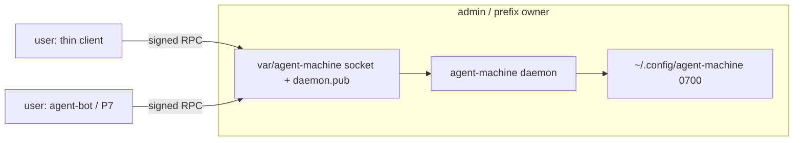

# Cross-account signed channel

Companion to [machine-daemon.md](machine-daemon.md) (P3–P8) and
[macos-signing.md](macos-signing.md). This file is the product path: admin
runs the executor; user and agent-bot are the clients. Pairing admin to
itself is not the product.

Owner direction (2026-11-02):

1. agent-machine talks to agent-bot over a signed protected channel. The
   intended path is every request through agent-bot.
2. A thin client still has to work from the user account when only
   agent-machine is installed, under the same signed-channel rules.

## Intent

The prefix-owner account (`admin`, uid 501) owns Homebrew and runs the
daemon. The daily account (`user`, uid 502) and agent-bot must call it.
Three things made that impossible on this machine and are the S1 fix:

| Failure | Cause | Fix in S1 |
|---|---|---|
| `daemon pair` as admin: OSStatus `-60008` / “A keychain cannot be found” | Login keychain is absent or locked for a non-GUI prefix-owner account. `kSecAttrAccessible` on a file keychain also prompts Authorization Services. | Dedicated `daemon.keychain-db` created and unlocked in-process with an empty password (never typed). No Data Protection attribute. Self-only ACL. Default keychain is restored after open. |
| Rebuild then `daemon run`: OSStatus `-2147415734` | Unsigned rebuild changes the binary hash; Darwin refuses `SecTrustedApplicationValidateWithPath`. | `Load` rebinds the ACL to the same path, or rotates the item if Darwin refuses the read. A different trusted-app path still fails closed. |
| User cannot reach a paired admin daemon | Socket was `0600` in a `0700` home; Gate required the daemon UID; `~/.config` is `0700` so admin cannot read `client.pub`. | Channel in prefix `var/agent-machine` (`0755`/`0666`), `daemon.pub` `0644`. Gate accepts any local UID whose signature is a live pairing key. `PairClient` mints `client.key` in the user state dir and prints the public key plus fingerprint for the prefix owner to enroll. |

S1 does not install software, does not start a LaunchAgent, and does not
talk to agent-bot. Those are S2–S5.

## Target



### Split of state

| Path | Owner | Mode | Contents |
|---|---|---|---|
| `~admin/.config/agent-machine` | prefix owner | `0700` | `daemon.keychain-db`, `peers/*`, private seed after migrate |
| `$HOMEBREW_PREFIX/var/agent-machine` | prefix owner | `0755` | `daemon.sock` `0666`, `daemon.pub` `0644` |
| `~user/.config/agent-machine` | user | `0700` | `client.key`, `client.pub` |

Windows keeps the named pipe. Linux uses the same prefix `var/` layout.

### Pairing

Two clients only: `terminal` and `agent-daemon`.

1. Admin: `daemon install [--user user]` writes the unit, loads it, and
   waits until the socket accepts.
2. User (next human command): mint `client.key` at home, `bootstrap` over
   the socket; the daemon adopts that pubkey for the connecting UID and
   returns `daemon.pub` in the reply. The client writes the pin. A missing
   `client.key` repeats this and replaces `peers/terminal.pub` for that UID.
3. After that, `daemon status` and `--update` sign with `client.key` and
   accept a response only when the pinned `daemon.pub` verifies it.
   `pair --enroll` remains for agent-daemon and a manual re-key.

`Caller.Refuse()` still blocks `install` / `run` / `unpair` / `enroll` for
a non-owner. `RefuseClient()` allows user `pair` and signed `status`.
Catalog remains agent-daemon-only.

### Darwin key store

See [macos-signing.md](macos-signing.md). Constraints from #446 stay: no
`.app` bundle, no Secure Enclave, no `keychain-access-groups`. The login
keychain is not used. Empty-password `SecKeychainCreate` must pass a
non-NULL empty buffer (`-50` if the pointer is NULL).
`SetUserInteractionAllowed(false)` is only around `Unlock`; leaving it
off for `SecItemAdd` yields `-25293`.

## Acceptance

### S1 — this change (proved 2026-11-02 on this machine)

- `go test ./internal/daemon` covers dedicated-keychain round-trip with no
  login keychain, stale-ACL rebind, default-keychain restore, channel
  modes `0755`/`0666`/`1733`, any-local-UID signed accept, negative
  peer UID refuse, purge that keeps the channel dir, and
  `TestThinClientStatusFromOtherUID`.
- Admin `daemon pair` writes the dedicated keychain item and
  `daemon.pub` next to the socket. A second unsigned rebuild of the same
  path still loads.
- User `daemon pair` prints the public key and fingerprint. It does not
  write into the channel directory.
- Admin `daemon pair --enroll HEX --fingerprint HEX` stages
  `peers/terminal.*`.
- User `daemon status` against a running admin daemon reports
  `channel=signed` and a daemon state. That is the product proof for S1.

### S2 — enroll UX (same repo)

Happy path does not pair. `daemon install` as the prefix owner starts
the executor. The next human thin-client call from the user account
mints `client.key` in that home (admin cannot write there) and sends a
signed `bootstrap` request. The daemon adopts that pubkey because the
unix-socket UID is the terminal user (`install --user NAME` pins it;
otherwise the first bootstrap pins the UID). The reply carries
`daemon.pub` in the body; the client writes the pin next to
`client.key`. Later calls are signed. If `client.key` disappears, the
same handshake replaces `peers/terminal.pub` for that UID. Agent
sessions do not mint a thin-client key. `pair --enroll HEX
--fingerprint HEX` remains for re-key and `--client agent-daemon`. The
daemon never reads a shared drop or a user-owned path.

### S3 — keep the executor up (same repo)

`daemon install` / `daemon start` as the prefix owner write the
LaunchAgent (KeepAlive, LimitLoadToSessionType Aqua/Background/StandardIO)
or the systemd user unit, load it without root, kickstart it, and wait
until the socket accepts. A bootstrap "not found" is a failure.
`daemon stop` unloads the unit. `daemon run` stays the foreground
entry the unit execs. Agent accounts, root, and a foreign HOME stay
refused. Windows writes the description and does not register a service.

### S4 — thin-client verbs that do work (same repo; machine-daemon P5/P6)

`daemon status` is `running` when the socket accepts, `installed` when
only the unit file exists, and `absent` otherwise. A signed RPC adds
`channel=signed`. From the user account the thin client runs `status`,
`receipts`, and `--update`. `plan` / `apply` stay closed except through
agent-daemon once P7 exists. `--update` falls back to the legacy script
only when no daemon is installed, or when the daemon is paired but has
no catalog (`MM_DAEMON_NOT_IN_CATALOG`).

### S5 — agent-bot is the control plane (other repos; P7/P8)

P7: agent-daemon client in agent-bot-identity, pairing through
agent-bot-keyd, same channel rules. P8: MCP `machine_request` /
`machine_result` / `machine_status` relay through agents.true-line.ai
(true-line/agent-bot#66, #71). The thin client remains the fallback
when agent-bot is not installed.

## Replay

1. Read this plan, [machine-daemon.md](machine-daemon.md),
   [macos-signing.md](macos-signing.md), and `AGENTS.md`.
2. Work in a soul worktree. Do not use the owner primary checkout.
3. S1 files: `internal/daemon/keychain_darwin.go`, `channel.go`,
   `listen_unix.go`, `pairing_file.go`, `protocol.go`, `run.go`,
   `caller.go`, `command.go`, `update_client.go`,
   `cmd/managed-machine/main.go`.
4. Gate: `gofmt -l . && go vet ./... && go test ./internal/daemon`.
   Full `go test ./...` is the CI gate; `cmd/mm-walkthrough` is
   long-running and is not required to land S1 locally.
5. Machine proof, as prefix owner then as user:

   ```sh
   # admin
   managed-machine daemon install --user user
   launchctl print user/$(id -u)/dev.qwts.agent-machine
   # user (no pair, no enroll paste)
   managed-machine daemon status
   ```

   Expected: launchctl `state = running`. User status `state=running`
   and `channel=signed`.
6. After S1 merges, open S2 from this file. Do not reopen the login
   keychain design. #442 Linux/Windows `daemon.key` and the parent-dir
   owner check stay on #442.
