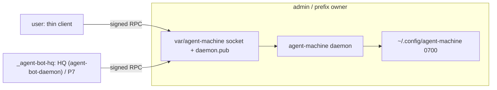

# Cross-account signed channel

Companion to [machine-daemon.md](machine-daemon.md) (P3–P8) and
[macos-signing.md](macos-signing.md). This file is the product path: admin
runs the executor; HQ (agent-bot-daemon) in its own `_agent-bot-hq` account
is the client. The thin client in `user` is a debug tool, off by default
(see [Debug client](#debug-client)).
Pairing admin to itself is not the product.

The platform is the source of truth for who holds what
([catalog](https://github.com/true-line/agent-bot-platform/blob/main/docs/03-architecture/repository-catalog.md),
[trust domains](https://github.com/true-line/agent-bot-platform/blob/main/docs/03-architecture/trust-domains-and-profiles.md),
[agent-bot-daemon D4 and D6](https://github.com/true-line/agent-bot-daemon/blob/main/docs/daemon-plugin-split.md#101-decisions),
[PDR-0027](https://github.com/true-line/agent-bot-platform/blob/main/docs/04-decisions/PDR-0027-hq-identity-authority-lives-in-agent-bot-daemon.md)):

- agent-machine, in `admin`, holds host-side credentials at rest and the
  signed policy, and verifies the owner's Secure Enclave presence signature
  on privileged requests (D4).
- HQ is agent-bot-daemon (D1). It runs in `_agent-bot-hq` on macOS and
  `agent-bot-hq` on Linux, an account agent-bot-machine creates, separate
  from `admin` and from `user` (D6). Its identity authority is HQ core, not
  an agent-bot-identity plugin (PDR-0027).

Owner direction (2026-11-02):

1. agent-machine talks to agent-bot over a signed protected channel. The
   intended path is every request through agent-bot. (Here agent-bot is
   HQ, agent-bot-daemon, per D1.)
2. A thin client still has to work from the user account when only
   agent-machine is installed, under the same signed-channel rules.

## Intent

The prefix-owner account (`admin`, uid 501) owns Homebrew and runs the
daemon. The owner's daily account (`user`, uid 502) and HQ, in
`_agent-bot-hq`, must call it.
Three things made that impossible on this machine and are the S1 fix:

| Failure | Cause | Fix in S1 |
|---|---|---|
| `daemon pair` as admin: OSStatus `-60008` / “A keychain cannot be found” | Login keychain is absent or locked for a non-GUI prefix-owner account. `kSecAttrAccessible` on a file keychain also prompts Authorization Services. | Dedicated `daemon.keychain-db` created and unlocked in-process with an empty password (never typed). No Data Protection attribute. Self-only ACL. Default keychain is restored after open. |
| Rebuild then `daemon run`: OSStatus `-2147415734` | Unsigned rebuild changes the binary hash; Darwin refuses `SecTrustedApplicationValidateWithPath`. | `Load` rebinds the ACL to the same path, or rotates the item if Darwin refuses the read. A different trusted-app path still fails closed. |
| User cannot reach a paired admin daemon | Socket was `0600` in a `0700` home; Gate required the daemon UID; `~/.config` is `0700` so admin cannot read `client.pub`. | Channel in prefix `var/agent-machine` (`0755`/`0666`), `daemon.pub` `0644`. Gate accepts any local UID whose signature is a live pairing key. `PairClient` mints `client.key` in the user state dir and prints the public key plus fingerprint for the prefix owner to enroll. |

S1 does not install software, does not start a LaunchAgent, and does not
talk to agent-bot. Those are S2–S5.

## Target



### Split of state

| Path | Owner | Mode | Contents |
|---|---|---|---|
| `~admin/.config/agent-machine` | prefix owner | `0700` | `daemon.keychain-db`, `peers/*`, private seed after migrate |
| `$HOMEBREW_PREFIX/var/agent-machine` | prefix owner | `0755` | `daemon.sock` `0666`, `daemon.pub` `0644` |
| `~user/.config/agent-machine` | user | `0700` | `terminal` `client.key`, `client.pub` |
| `~_agent-bot-hq/.config/agent-machine` | HQ account | `0700` | `agent-daemon` `client.key`, `client.pub`, pinned `daemon.pub` |

Windows keeps the named pipe. Linux uses the same prefix `var/` layout, with
HQ in `agent-bot-hq`. Neither members nor the owner's `user` account can read
the `agent-daemon` key (D6).

**Until `_agent-bot-hq` exists.** Today's agent-bot daemon still runs in
`user` and keeps the `agent-daemon` key there. That is D4's stated residual
risk: any `user` process can use the key for routine brokered requests
(status, receipts), never for a raw secret, and privileged and policy
requests stay out of reach because they need the presence signature. Moving
HQ into its own account (S6) closes it.

### Debug client

Owner direction (2026-11-10): HQ is the intended caller of agent-machine.
The thin client is a debug tool, not the mechanism, and the daemon allows
it only in debug mode.

- Debug mode is off by default. The prefix owner turns it on with
  `daemon install --debug` and off again with a plain `daemon install`.
  `daemon start` keeps the current mode. The install record reports
  `debug_client=on|off`. `--user NAME` is valid only with
  `install --debug`.
- While it is off the daemon refuses `bootstrap`, and an enrolled
  `terminal` key is not a live pairing: its requests get
  `MM_DAEMON_UNKNOWN_KEY`. The `agent-daemon` key is not affected.
- Consequence: with the daemon installed and debug mode off,
  `managed-machine --update` from `user` is refused with a message that
  names `daemon install --debug`. Updates then come through HQ.

The pairing steps for the `terminal` client below apply only while debug
mode is on.

### Pairing

Two clients only: `terminal` (the owner, in `user`) and `agent-daemon`
(HQ, in `_agent-bot-hq`).

1. Admin: `daemon install [--debug [--user user]]` writes the unit, loads it, and
   waits until the socket accepts.
2. User (next human command): create `~/.config/agent-machine` at `0700`
   if it is missing, mint `client.key` there, and `bootstrap` over the
   socket. The daemon adopts that pubkey for the connecting UID and
   returns `daemon.pub` in the reply. The client writes the pin. A
   bootstrap signed by the enrolled `agent-daemon` key is refused, so
   that key is never copied onto `peers/terminal.pub`. A missing
   `client.key` repeats this and replaces `peers/terminal.pub` for that UID.
3. After that, `daemon status`, `receipts`, and `--update` sign with
   `client.key` and accept a response only when the pinned `daemon.pub`
   verifies it. The first `--update` enrolls when the socket accepts, and
   stays unhandled when it does not. `pair --enroll` remains for
   agent-daemon and a manual re-key.

`Caller.Refuse()` still blocks `install` / `run` / `unpair` / `enroll` for
a non-owner. `RefuseClient()` allows user `pair` and signed `status`.
Catalog remains agent-daemon-only.

### Darwin key store

See [macos-signing.md](macos-signing.md). Constraints from #446 stay: no
`.app` bundle, no Secure Enclave, no `keychain-access-groups`. The login
keychain is not used. Empty-password `SecKeychainCreate` must pass a
non-NULL empty buffer (`-50` if the pointer is NULL).
`SetUserInteractionAllowed(false)` is only around `Unlock`; leaving it
off for `SecItemAdd` yields `-25293`.

## Acceptance

### S1 — this change (proved 2026-11-02 on this machine)

- `go test ./internal/daemon` covers dedicated-keychain round-trip with no
  login keychain, stale-ACL rebind, default-keychain restore, channel
  modes `0755`/`0666`/`1733`, any-local-UID signed accept, negative
  peer UID refuse, purge that keeps the channel dir, and
  `TestThinClientStatusFromOtherUID`.
- Admin `daemon pair` writes the dedicated keychain item and
  `daemon.pub` next to the socket. A second unsigned rebuild of the same
  path still loads.
- User `daemon pair` prints the public key and fingerprint. It does not
  write into the channel directory.
- Admin `daemon pair --enroll HEX --fingerprint HEX` stages
  `peers/terminal.*`.
- User `daemon status` against a running admin daemon reports
  `channel=signed` and a daemon state. That is the product proof for S1.

### S2 — enroll UX (same repo)

With the debug client on, the user does not pair. `daemon install --debug`
as the prefix owner starts the executor. The next human thin-client call from the user account
creates `~/.config/agent-machine` at `0700` when it is missing, mints
`client.key` in that home (admin cannot write there), and sends a
signed `bootstrap` request. A request signed by the enrolled
`agent-daemon` key is refused. The daemon adopts a terminal pubkey because the
unix-socket UID is the terminal user (`install --debug --user NAME` pins it;
otherwise the first bootstrap pins the UID). The reply carries
`daemon.pub` in the body; the client writes the pin next to
`client.key`. Later calls are signed. If `client.key` disappears, the
same handshake replaces `peers/terminal.pub` for that UID. Agent
sessions do not mint a thin-client key. `pair --enroll HEX
--fingerprint HEX` remains for re-key and `--client agent-daemon`. The
daemon never reads a shared drop or a user-owned path.

### S3 — keep the executor up (same repo)

`daemon install` / `daemon start` as the prefix owner write the
LaunchAgent (KeepAlive, LimitLoadToSessionType Aqua/Background/StandardIO)
or the systemd user unit, load it without root, kickstart it, and wait
until the socket accepts. A bootstrap "not found" is a failure.
`daemon stop` unloads the unit. `daemon run` stays the foreground
entry the unit execs. Agent accounts, root, and a foreign HOME stay
refused. Windows writes the description and does not register a service.

### S4 — thin-client verbs that do work (same repo; machine-daemon P5/P6)

`daemon status` is `running` when the socket accepts, `installed` when
only the unit file exists, and `absent` otherwise. A signed RPC adds
`channel=signed`. From the user account the thin client runs `status`,
`receipts`, and `--update`. `plan` / `apply` stay closed except through
agent-daemon once P7 exists. `--update` falls back to the legacy script
only when no daemon is installed, or when the daemon is paired but has
no catalog (`MM_DAEMON_NOT_IN_CATALOG`).

### S5 — agent-bot is the control plane (other repos; P7/P8)

P7: the `agent-daemon` client is part of HQ core in agent-bot-daemon
(PDR-0027), running in `_agent-bot-hq`. It pairs with agent-machine directly
over this channel, under the same rules. Key custody and signing move from
keyd into agent-bot-machine (D4), so pairing does not go through
agent-bot-keyd. Privileged and policy requests also carry the owner's
presence signature, which agent-machine verifies (D4). P8: MCP
`machine_request` / `machine_result` / `machine_status` from
agents.true-line.ai (true-line/agent-bot#66, #71) reach agent-machine only
through HQ. HQ authorizes each request and alone signs it on this channel;
the identity service and relays get no execution channel
([R2](https://github.com/true-line/agent-bot-platform/blob/main/docs/02-requirements/product-requirements.md#r2-control-stays-local)).
The thin client is a debug tool, off unless the prefix owner turns on debug
mode.

### S6 — HQ account (this repo, D6)

agent-bot-machine creates the HQ role account, `_agent-bot-hq` on macOS and
`agent-bot-hq` on Linux, separate from `admin` and from `user`. HQ's
`agent-daemon` key moves there, and the `user` copy is retired. Members and
the owner's account cannot read HQ's store or key.

**As built, Linux** ([#475](https://github.com/true-line/agent-bot-machine/issues/475)).
`managed-machine members plan --hq-account agent-bot-hq ...` plans the
account as its first step when it is missing, and the approved
`sudo managed-machine members apply` creates it: a locked service account
with a private group, shell `nologin` and home `/var/lib/agent-bot-hq` at
0700. It uses the plan, approval and root apply of
[member-accounts.md](member-accounts.md); there is no separate verb. An
account that already exists is verified or, when it is a person's account,
left alone and named as shared in the plan.

Still to come:

- macOS: `_agent-bot-hq`, with HQ plan row 29.
- HQ itself moves into the account, mints its `agent-daemon` key there,
  pairs with `pair --enroll ... --client agent-daemon`, and the copy in
  `user` is retired. That is agent-bot-hq's change.

**As built: the `agent-daemon` key is bound to the HQ account**
([#484](https://github.com/true-line/agent-bot-machine/issues/484)).
`daemon pair --enroll HEX --fingerprint HEX --client agent-daemon` binds
the key to an account and records its UID in `agent-daemon.uid` in the
daemon's state directory. With `--user NAME` it binds to that account.
Without it, it binds to the dedicated HQ account (`agent-bot-hq`, or
`_agent-bot-hq` on macOS) when the machine has one. The record reports
`uid=<n>`, or `uid=any` when the key is not bound. A bound key is accepted
only from that UID; from any other account the request gets
`MM_DAEMON_PEER_REFUSED`. Agent accounts cannot be bound.

HQ in the owner's own account stays allowed: with no dedicated account and
no `--user`, the key is not bound and works as before. A key enrolled
before this change is not bound until it is enrolled again. On Windows the
peer is not a numeric UID, so the key is never bound there.

## Replay

1. Read this plan, [machine-daemon.md](machine-daemon.md),
   [macos-signing.md](macos-signing.md), and `AGENTS.md`.
2. Work in a soul worktree. Do not use the owner primary checkout.
3. S1 files: `internal/daemon/keychain_darwin.go`, `channel.go`,
   `listen_unix.go`, `pairing_file.go`, `protocol.go`, `run.go`,
   `caller.go`, `command.go`, `update_client.go`,
   `cmd/managed-machine/main.go`.
4. Gate: `gofmt -l . && go vet ./... && go test ./internal/daemon`.
   Full `go test ./...` is the CI gate; `cmd/mm-walkthrough` is
   long-running and is not required to land S1 locally.
5. Machine proof, as prefix owner then as user:

   ```sh
   # admin
   managed-machine daemon install --debug --user user
   launchctl print user/$(id -u)/dev.qwts.agent-machine
   # user (no pair, no enroll paste)
   managed-machine daemon status
   ```

   Expected: launchctl `state = running`. User status `state=running`
   and `channel=signed`.
6. After S1 merges, open S2 from this file. Do not reopen the login
   keychain design. #442 Linux/Windows `daemon.key` and the parent-dir
   owner check stay on #442.
